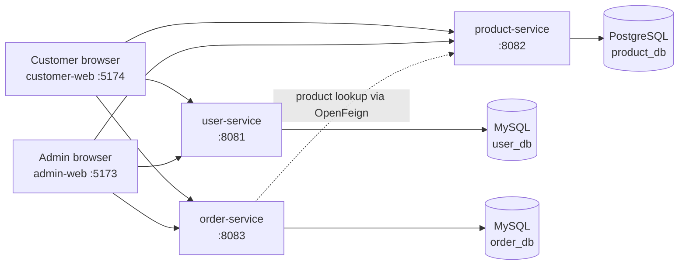

# E-commerce Microservices

A learning e-commerce project with two React/Vite web applications and three
Spring Boot REST services. The customer storefront and admin workspace are
separate frontends; the backend separates user authentication, product catalog,
and order management.

Customer Google sign-in uses OpenID Connect, a short-lived backend OAuth
session, explicit local customer identity resolution, and a CSRF-protected
exchange for this application's JWT. Admin login remains email/password.
Follow the [Google OAuth interview and implementation guide](./docs/GOOGLE_OAUTH2_INTERVIEW_GUIDE.md)
for the flow, code map, configuration, security rationale, and interview
questions. Open the [interactive OAuth learning page](./docs/google-oauth2-learning.html)
for a clickable flow diagram and step-by-step explanation.

## Architecture



The frontends currently mix service integration with demo data. The customer
login/register and profile flows call `user-service`, while the customer
catalog/cart and most admin dashboard/list data are still mocked. Checkout is
disabled; the admin UI labels its service integration as pending.

| Component | Responsibilities | Local URL / port | Data store |
|---|---|---|---|
| `customer-web` | Storefront, product browsing, local cart, customer account screens | `http://localhost:5174` | Browser storage for demo cart/session |
| `admin-web` | Admin login, dashboard, order/product/category/user screens | `http://localhost:5173` | Mock dashboard/list data |
| `user-service` | Registration, login, profiles, user and role management; JWT authentication | `http://localhost:8081` | MySQL `user_db` |
| `product-service` | Product and category REST APIs | `http://localhost:8082` | PostgreSQL `product_db` |
| `order-service` | Order APIs, authorization, and product-service client | `http://localhost:8083` | MySQL `order_db` |

Frontend defaults and examples now match the backend ports: product uses
`8082` and order uses `8083`. Check any existing local `.env` overrides too.

## Repository layout

```text
.
├── backend/
│   ├── user-service/       # Spring Boot auth and user API
│   ├── product-service/    # Spring Boot catalog API
│   └── order-service/      # Spring Boot order API
└── frontend/
    ├── admin-web/          # React + Vite admin application
    ├── customer-web/       # React + Vite storefront
    └── LEARNING_ARCHITECTURE.md
```

## Requirements

- Node.js and npm for the frontends.
- JDK 21 for the Spring Boot services.
- MySQL reachable on port `3306` with databases `user_db` and `order_db`.
- PostgreSQL reachable on port `5432` with database `product_db`.
- Configure `DB_PASSWORD` and optional `DB_USERNAME` for each service. Local
  `dev` profiles share a development-only JWT fallback; set `JWT_SECRET` to a
  private value shared by all services when needed. Production and Docker runs
  still require `JWT_SECRET`. Google OAuth uses local placeholders unless
  `GOOGLE_CLIENT_ID` and `GOOGLE_CLIENT_SECRET` are set for user-service; real
  Google sign-in requires those credentials. Keep real secrets out of source
  control.

The database must be available before starting its service. The individual
`backend/*/compose.yaml` files are Spring Boot Docker Compose development
configurations; verify their database name and credentials match your local
database setup before relying on them.

## Run the frontends

Run each app in a separate terminal. From the repository root in PowerShell:

```powershell
Set-Location .\frontend\admin-web
npm install
npm run dev
```

```powershell
Set-Location .\frontend\customer-web
npm install
npm run dev
```

Open:

- Admin: [http://localhost:5173](http://localhost:5173)
- Storefront: [http://localhost:5174](http://localhost:5174)

Install dependencies once per frontend. If PowerShell blocks the `npm` script,
use `npm.cmd` in place of `npm`. Each frontend can also be built with
`npm run build` from its own directory. The admin/customer Vite configs use
ports `5173`/`5174` and require those ports to be free.

### Frontend routes

Customer:

- `/` — storefront
- `/products` — product catalog
- `/cart` — browser-persisted demo cart; checkout is not connected
- `/login` — customer email/password or Google sign-in
- `/auth/callback` — completes Google sign-in and exchanges the temporary session
- `/register`, `/profile` — customer account screens

Admin:

- `/login` — admin login
- `/dashboard` — sample dashboard
- `/orders`, `/products`, `/categories`, `/users`, `/profile` — workspace screens

The frontend reads service URLs from `VITE_USER_SERVICE_URL`,
`VITE_PRODUCT_SERVICE_URL`, and `VITE_ORDER_SERVICE_URL`. These values are
public browser configuration, not a place for secrets. For the current backend
ports, use:

```dotenv
VITE_USER_SERVICE_URL=http://localhost:8081
VITE_PRODUCT_SERVICE_URL=http://localhost:8082
VITE_ORDER_SERVICE_URL=http://localhost:8083
```

Copy each frontend's `.env.example` to `.env` before overriding its defaults.
The customer Vite dev server proxies `/user-service` to the user service;
configure backend CORS for direct browser requests to other services.

## Run the backend services

Start and configure the databases first. Then start each service in its own
terminal from the repository root:

```powershell
Set-Location .\backend\user-service
.\mvnw.cmd spring-boot:run
```

```powershell
Set-Location .\backend\product-service
.\mvnw.cmd spring-boot:run
```

```powershell
Set-Location .\backend\order-service
.\mvnw.cmd spring-boot:run
```

The wrapper uses the project's Maven configuration. Each service also has a
`Dockerfile`; backend container orchestration should be reviewed before use:
the root `docker-compose.yml` currently references service build folders at
the repository root, whereas the checked-in services are under `backend/`.

## Current API entry points

The implemented controllers currently expose these routes:

- `user-service`: `/api/auth/register`, `/api/auth/login`,
  `/api/auth/logout`; user, admin-user, and profile endpoints are also under
  `/api` in their respective controllers.
- `product-service`: `/api/products`, `/api/products/{id}` and product
  create/update/delete operations; category routes are provided by
  `CategoryController`.
- `order-service`: `/api/orders`, `/api/orders/{id}`,
  `/api/orders/{productId}`, and `/api/orders/user/{userId}`.

Consult the controllers for request/response details and access rules. The
services are not yet a fully integrated production checkout flow. In
particular, the frontend demo data is not automatically synchronized with the
backend APIs.

## Build the frontends

From each frontend directory:

```sh
npm install
npm run build
```

Build output is written to that app's `dist/` directory. For production hosting,
serve the output with a single-page-application fallback to `index.html` and
configure the service URLs for the deployment environment.

For the React structure, API integration notes, and learning walkthrough, see
[frontend/LEARNING_ARCHITECTURE.md](./frontend/LEARNING_ARCHITECTURE.md).
