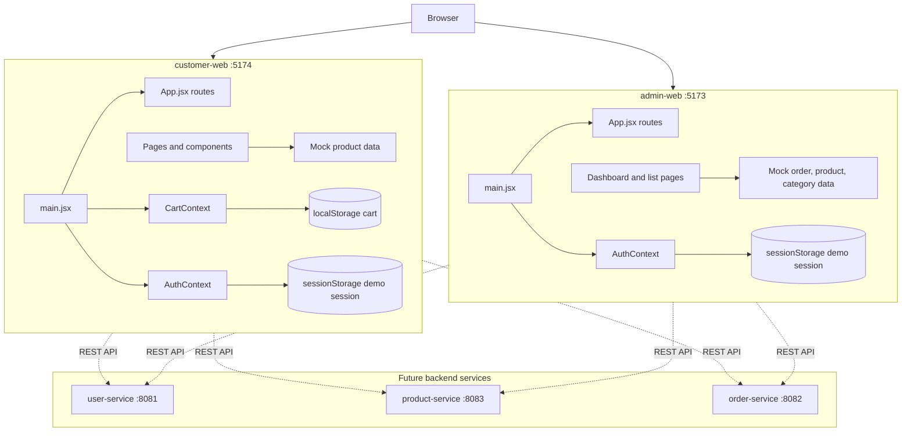
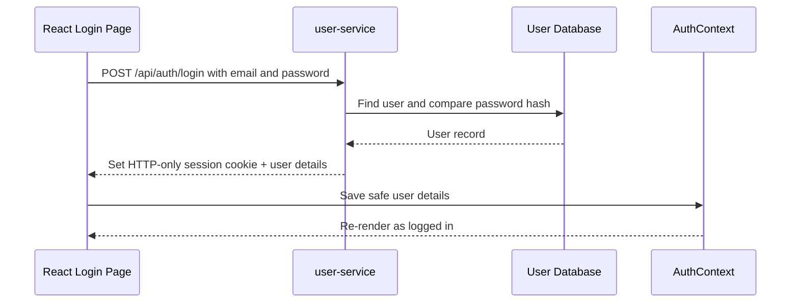

# E-commerce React and REST API learning architecture

This guide describes the current `admin-web` and `customer-web` applications and gives a safe, incremental plan for replacing demo data with REST APIs.

The goal is to understand each layer before adding the next one. Build and verify one step at a time.

## 1. Current application map



## 2. Current React folders

```text
frontend/
├── admin-web/
│   └── src/
│       ├── App.jsx                 # Routes, admin layout, dashboard
│       ├── main.jsx                # React entry point
│       ├── config/services.js      # Service base URLs
│       ├── context/AuthContext.jsx # Demo admin login state
│       ├── data/                   # Demo orders, products, categories
│       ├── pages/Lists.jsx         # Orders, products, categories pages
│       └── services/api.js         # Shared fetch helper
│
├── customer-web/
│   └── src/
│       ├── App.jsx                    # Routes
│       ├── main.jsx                   # React entry point
│       ├── components/                # Layout and product catalog
│       ├── config/services.js         # Service base URLs
│       ├── context/AuthContext.jsx    # Demo customer login state
│       ├── context/CartContext.jsx    # Browser-only cart state
│       ├── data/products.js           # Demo product data
│       ├── pages/                     # Shop, products, cart, login
│       └── services/api.js            # Shared fetch helper
│
└── LEARNING_ARCHITECTURE.md
```

## 3. What React is doing now

| React feature | Where it is used | What it does |
|---|---|---|
| Component | `Shop`, `Cart`, `Login`, `Dashboard` | A reusable piece of UI written as a JavaScript function. |
| Route | Both `App.jsx` files | Shows a page for a browser path such as `/products` or `/orders`. |
| Context | `AuthContext`, `CartContext` | Shares state between distant components without passing props through every layer. |
| `useState` | Login, filters, cart | Stores data that causes React to render the UI again when changed. |
| `useEffect` | `CartContext` | Runs work after rendering; it currently saves the cart to `localStorage`. |
| `localStorage` | Customer cart | Keeps the demo cart after a page refresh in the same browser. |
| `sessionStorage` | Demo login contexts | Keeps the demo logged-in email until the browser tab closes. |

## 4. Routes in the current applications

### Customer application

| Route | Page | Current source |
|---|---|---|
| `/` | Store home and product preview | `pages/Shop.jsx` |
| `/products` | Full product list | `pages/Products.jsx` |
| `/cart` | Cart and subtotal | `pages/Cart.jsx` |
| `/login` | Demo login | `pages/Login.jsx` |

### Admin application

| Route | Page | Current source |
|---|---|---|
| `/login` | Demo admin login | `App.jsx` |
| `/dashboard` | Store dashboard | `App.jsx` |
| `/orders` | Order list | `pages/Lists.jsx` |
| `/products` | Product list | `pages/Lists.jsx` |
| `/categories` | Category list | `pages/Lists.jsx` |

## 5. Recommended REST API ownership

Keep each service responsible for one business area.

| Service | Owns | Does not own |
|---|---|---|
| `user-service` | Registration, login, logout, customer profile, roles | Product price, product stock, orders |
| `product-service` | Products, categories, stock, current price | Passwords, payment, order history |
| `order-service` | Orders, order items, order status, totals | Product catalog editing, password verification |

## 6. Initial API contract

Use `/api` as a common prefix. You can change names later, but agree on the contract before connecting React.

### user-service — `http://localhost:8081/api`

| Method | Endpoint | Purpose |
|---|---|---|
| `POST` | `/auth/register` | Create a customer account. |
| `POST` | `/auth/login` | Verify email and password, start a session. |
| `POST` | `/auth/logout` | End the current session. |
| `GET` | `/auth/me` | Return the logged-in user and role. |

Register request:

```json
{
  "name": "Rahul Kumar",
  "email": "rahul@example.com",
  "password": "A-strong-password"
}
```

Successful login or `GET /auth/me` response:

```json
{
  "id": "user-101",
  "name": "Rahul Kumar",
  "email": "rahul@example.com",
  "role": "CUSTOMER"
}
```

The backend must store only a secure password hash, never the original password.

### product-service — `http://localhost:8083/api`

| Method | Endpoint | Purpose |
|---|---|---|
| `GET` | `/products` | List public products. |
| `GET` | `/products/:id` | Read one product. |
| `GET` | `/categories` | List categories. |
| `POST` | `/admin/products` | Create a product for an admin. |
| `PATCH` | `/admin/products/:id` | Edit a product for an admin. |
| `DELETE` | `/admin/products/:id` | Remove a product for an admin. |
| `POST` | `/admin/categories` | Create a category for an admin. |

Example product response:

```json
{
  "id": "p1",
  "sku": "ACC-001",
  "name": "Everyday backpack",
  "category": {
    "id": "cat-1",
    "name": "Accessories"
  },
  "price": 64,
  "currency": "USD",
  "stock": 35,
  "description": "Room for everything that matters.",
  "imageUrl": null
}
```

### order-service — `http://localhost:8082/api`

| Method | Endpoint | Purpose |
|---|---|---|
| `POST` | `/orders` | Create an order for the logged-in customer. |
| `GET` | `/orders/my` | List orders belonging to the logged-in customer. |
| `GET` | `/admin/orders` | List all orders for an admin. |
| `GET` | `/admin/orders/:id` | Read one order for an admin. |
| `PATCH` | `/admin/orders/:id/status` | Change order status for an admin. |

Create-order request from React:

```json
{
  "items": [
    { "productId": "p1", "quantity": 2 },
    { "productId": "p3", "quantity": 1 }
  ]
}
```

Do not send a trusted product price or trusted total from React. `order-service` must obtain the current product price and stock from `product-service`, then calculate the final total itself.

## 7. Authentication flow

Use an HTTP-only secure cookie for the login session. React stores only safe user details such as ID, name, email, and role in `AuthContext`.



At application startup, call `GET /api/auth/me`. If it succeeds, restore the user in `AuthContext`; if it returns `401`, show the logged-out UI.

Because the frontends and services use different ports during development, configure backend CORS to allow:

```text
http://localhost:5173
http://localhost:5174
```

For cookie sessions, client requests must use `credentials: "include"` and the backend must permit credentials in its CORS configuration.

## 8. Step-by-step development plan

### Step 1 — Understand the current pages

1. Run both frontend projects.
2. Use customer routes: `/`, `/products`, `/cart`, `/login`.
3. Use admin routes: `/login`, `/dashboard`, `/orders`, `/products`, `/categories`.
4. Find where each page currently imports mock data.
5. Do not connect APIs yet.

**Completion check:** You can explain the difference between a page component, route, context, and mock-data file.

### Step 2 — Build user-service first

1. Create a users database table or collection.
2. Create `POST /api/auth/register`.
3. Hash passwords in the backend using a password-hashing library.
4. Create `POST /api/auth/login`.
5. Set an HTTP-only cookie when login succeeds.
6. Create `GET /api/auth/me`.
7. Test every endpoint with Postman, Insomnia, or Bruno before touching React.

**Completion check:** A customer and an admin can log in, and `GET /auth/me` returns the correct role.

### Step 3 — Connect customer login and registration

1. Add a customer registration page.
2. Replace the demo `login(email)` function in `customer-web/src/context/AuthContext.jsx`.
3. Call `POST /api/auth/login` from the login form.
4. Call `GET /api/auth/me` when the app starts.
5. Replace the demo sign-out function with `POST /api/auth/logout`.
6. Show API loading and error messages in the login form.

**Completion check:** Refreshing the customer application keeps a valid logged-in user signed in through the backend session.

### Step 4 — Connect admin login and role protection

1. Reuse the same user-service login endpoint.
2. On `GET /api/auth/me`, check `role === "ADMIN"` in the frontend for routing.
3. The backend must also require the `ADMIN` role on every `/api/admin/*` endpoint.
4. Replace the admin demo `AuthContext` session behavior.
5. Keep an unauthorized customer out of admin pages.

**Completion check:** A customer cannot open an admin API endpoint, even if they type the admin URL manually.

### Step 5 — Build product-service APIs

1. Create products and categories tables or collections.
2. Implement public `GET /api/products` and `GET /api/categories`.
3. Add optional query parameters, for example `/api/products?category=cat-1&search=backpack`.
4. Implement admin product and category create/edit/delete endpoints.
5. Test validation: missing name, negative price, invalid category, invalid stock.

**Completion check:** Product APIs return a stable JSON shape and reject invalid data with useful error messages.

### Step 6 — Connect product data in both frontends

1. Replace `customer-web/src/data/products.js` with a product-service request.
2. Add React loading, error, and empty states to the customer catalog.
3. Replace `admin-web/src/data/catalog.js` with product-service requests.
4. Keep product filters in React first; later move filtering to API query parameters for larger catalogs.
5. Use the same backend product ID in customer and admin applications.

**Completion check:** Changing a product through an admin API is visible in the customer product list after refresh.

### Step 7 — Keep the cart local at first

1. Keep the existing `CartContext` and `localStorage` cart during initial learning.
2. Store only `{ id, quantity }` in the browser.
3. Calculate the display subtotal from product data only for UI preview.
4. Do not consider the browser subtotal final.

**Completion check:** Cart quantity changes remain after page refresh and invalid quantities are prevented.

### Step 8 — Build and connect order-service

1. Create order and order-item tables or collections.
2. Implement `POST /api/orders`.
3. Read the logged-in user from the backend session.
4. Validate every product ID and quantity.
5. Ask product-service for current price and stock.
6. Create the order with a server-calculated total.
7. Reduce stock only after the order is accepted.
8. Return the created order.
9. Replace the disabled checkout button in the customer cart.

**Completion check:** A valid cart creates an order, and the server total remains correct even if browser data is changed manually.

### Step 9 — Connect customer and admin order lists

1. Add a customer `/orders` page that calls `GET /api/orders/my`.
2. Replace admin mock orders with `GET /api/admin/orders`.
3. Add an admin order-detail page.
4. Add an admin status update action using `PATCH /api/admin/orders/:id/status`.
5. Define allowed statuses, for example `PENDING`, `PROCESSING`, `SHIPPED`, `DELIVERED`, and `CANCELLED`.

**Completion check:** Customers see only their own orders; admins can see and manage all orders.

### Step 10 — Improve structure after APIs work

1. Create feature-based folders, such as `features/auth`, `features/products`, and `features/orders`.
2. Move request functions into service-specific modules such as `services/authApi.js` and `services/productApi.js`.
3. Add reusable `LoadingState`, `ErrorState`, and `EmptyState` components.
4. Add API tests and frontend component tests.
5. Add a shared API error format across all backend services.

**Completion check:** Each feature has clear ownership, and API errors display consistently across both applications.

## 9. Recommended frontend API pattern

The current `apiRequest` helper is a good starting point. Keep requests in a service layer, rather than placing raw `fetch` calls throughout page components.

Example future product API module:

```js
import { apiRequest } from "./api";

export function getProducts(query = "") {
  return apiRequest("product", `/api/products${query}`);
}

export function getCategories() {
  return apiRequest("product", "/api/categories");
}
```

Then a page asks the API module for data, stores it in React state, and renders it:

```text
Page component → API module → apiRequest helper → REST service → database
                                      ↓
                                  JSON response
                                      ↓
                                React state → UI
```

## 10. API states every React page should handle

Every page that loads server data should consider these four states:

| State | Meaning | UI example |
|---|---|---|
| Loading | Request has started but no response yet. | Spinner or “Loading products…” text. |
| Success | API returned valid data. | Product cards or order rows. |
| Empty | API returned an empty list. | “No products found.” |
| Error | Request failed or server returned an error. | “Could not load products. Try again.” |

## 11. Security rules to keep from the beginning

1. Hash passwords in user-service.
2. Use HTTPS in production.
3. Prefer HTTP-only cookies over storing authentication tokens in `localStorage`.
4. Validate all request input in the backend.
5. Authorize every protected API endpoint in the backend; frontend route guards are only a user experience feature.
6. Do not trust price, total, role, stock, or order status sent by React.
7. Restrict CORS to the real frontend origins.
8. Never put passwords, backend secrets, or database credentials in `VITE_*` environment variables. Vite exposes these values to the browser.

## 12. Suggested milestone order

```mermaid
flowchart LR
  A[1. Learn current React structure] --> B[2. user-service APIs]
  B --> C[3. Customer register and login]
  C --> D[4. Admin login and roles]
  D --> E[5. product-service APIs]
  E --> F[6. Product lists use APIs]
  F --> G[7. Keep local cart]
  G --> H[8. order-service and checkout]
  H --> I[9. Customer and admin orders]
  I --> J[10. Tests, polish, deployment]
```



Start with authentication. It establishes the user identity required for protected admin product operations and customer order creation.
