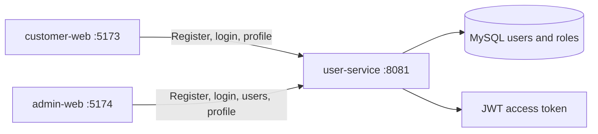
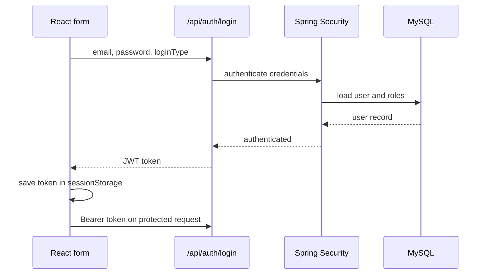

# React and REST API learning guide

This project has two React applications that use the same `user-service`.

## 1. What each application does

| Application | Main users | React responsibility | Backend access |
| --- | --- | --- | --- |
| `customer-web` | Customers | Shop, cart, customer registration, login, profile | Customer account and own profile |
| `admin-web` | Store staff | Dashboard, product/order/category screens, registered user list, profile | User-role account, user list, own profile |
| `user-service` | Both applications | Authentication, registration, roles, profile data | MySQL and JWT generation |

## 2. Registration flow

1. A React form reads fields with `FormData`.
2. The frontend service sends JSON to `POST /api/auth/register`.
3. Spring validates the JSON using `RegisterRequest`.
4. `AuthService` hashes the password with Spring Security's password encoder.
5. It creates a `User`, adds the requested permitted role, and saves it in MySQL.
6. The UI displays either the backend message or its validation error.

Customer registration sends `registrationType: "CUSTOMER"`. Admin registration sends `registrationType: "USER"`.

## 3. Login and JWT flow

The admin login sends `loginType: "ADMIN"`. The backend accepts that request only when the database user has `ROLE_ADMIN`, `ROLE_USER`, or `ROLE_EMPLOYEE`. A `ROLE_CUSTOMER` account receives `403 Administrator access is required`.

## 4. Profile APIs

| Method | Endpoint | Who can call it | Purpose |
| --- | --- | --- | --- |
| `GET` | `/api/users/me` | Any authenticated user | Read the current user's profile |
| `PATCH` | `/api/users/me` | Any authenticated user | Update first name, last name, gender, and mobile |
| `GET` | `/api/admin/users` | `ADMIN`, `USER`, `EMPLOYEE` | Show every registered user and role |

The browser sends `Authorization: Bearer <token>`. `JwtAuthenticationFilter` verifies the token, reads the role claims, and adds them to Spring Security's authentication context. The controller then uses `authentication.getName()` to find the logged-in user; it never accepts a user ID from the browser for “my profile”.

`UserProfileResponse` is a DTO. It intentionally exposes profile information and roles but does **not** expose the password hash. This is an important API design point for interviews.

## 5. React file responsibilities

| Layer | Example | Why it exists |
| --- | --- | --- |
| Page | `pages/Profile.jsx` | Renders form fields, loading state, error state, and success message |
| Context | `context/AuthContext.jsx` | Keeps the signed-in session available across components |
| API service | `services/userApi.js` / `services/profileApi.js` | Keeps `fetch` and endpoint details out of components |
| Router | `App.jsx` | Maps URLs such as `/profile` and `/users` to pages |
| Backend DTO | `UserProfileResponse` | Controls exactly what JSON the API returns |

## 6. Interview explanation

Use this short explanation:

> “I separated UI pages, authentication state, and API calls in React. The login endpoint returns a JWT. React stores the temporary learning-project session in session storage and sends it as a Bearer token on protected requests. Spring Security validates the JWT, loads role authorities, and protects endpoints with role checks. The profile endpoint derives the user from the token instead of trusting a client-supplied user ID. Admin user-list responses use a DTO so password hashes are never sent to the frontend.”

Useful follow-up answers:

- **Why Context?** It avoids passing the logged-in user through many component props.
- **Why a service file?** It centralizes URL, headers, JSON parsing, and error handling.
- **Why `PATCH` for profile?** It changes selected profile fields instead of replacing the whole user record.
- **Why DTOs?** Entity classes may contain private database fields such as passwords, internal IDs, or relationships.
- **How do roles work?** Roles are stored in the database, copied into the JWT at login, converted to Spring `GrantedAuthority` values, and checked with `hasRole` or `hasAnyRole`.
- **How would production improve token storage?** Evaluate an HTTP-only secure cookie and CSRF protection rather than treating browser storage as the final design.

## 7. Next learning tasks

1. Add server-side pagination to `/api/admin/users`.
2. Add an admin-only role-update endpoint with audit history.
3. Add password-reset tokens with expiry and email delivery.
4. Connect product and order pages to their microservices.
5. Add automated controller and React component tests.
